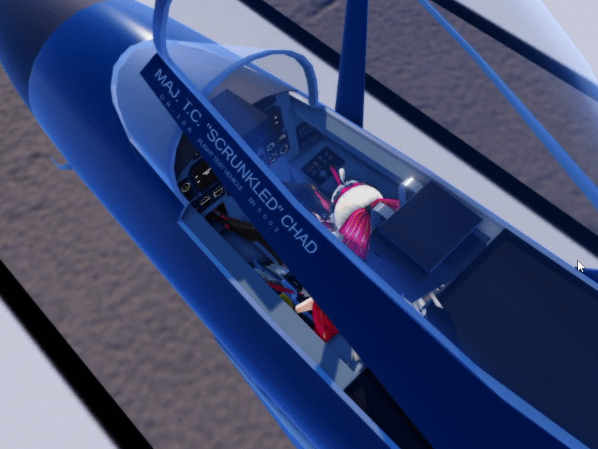
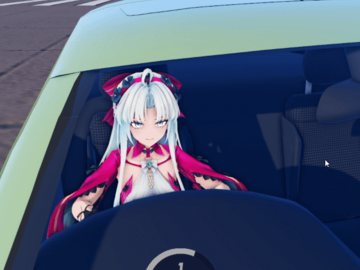
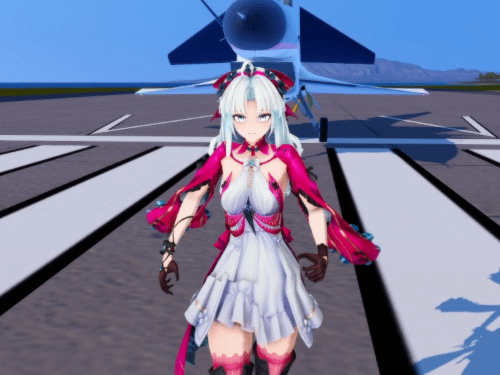
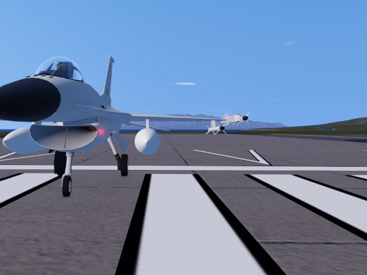

# SimplePlanes 2 — Carlotta Avatar Replacement Mod

A custom VRM avatar replacement project for SimplePlanes 2.

This mod replaces the default Chad character with Carlotta from Wuthering Waves, while preserving and adapting the game's existing character animations.

## Features

- Humanoid animation retargeting
- Eye and head tracking
- Cockpit controls and hand IK
- Acceleration, deceleration, and lateral G-force reactions
- Walking, swimming, and falling animations
- Custom idle animations for on-foot and lobby states
- Procedural hair and clothing physics
- Facial expressions and automatic blinking
- Avatar replacement across Main Menu, Build, Fly, and On-Foot modes

## Gameplay Demonstrations

### Sight Tracking

### G-Force Reactions

 

### On-Foot Animations

  

### Lobby Idle Animations

## Development Status

**Current development version: v0.1**

Core avatar replacement and animation features are implemented. Performance optimization and compatibility testing are ongoing.

## Disclaimer

This is an unofficial, non-commercial fan project. It is not affiliated with Jundroo or Kuro Games.

Third-party character and animation assets are not distributed without the appropriate permissions.
