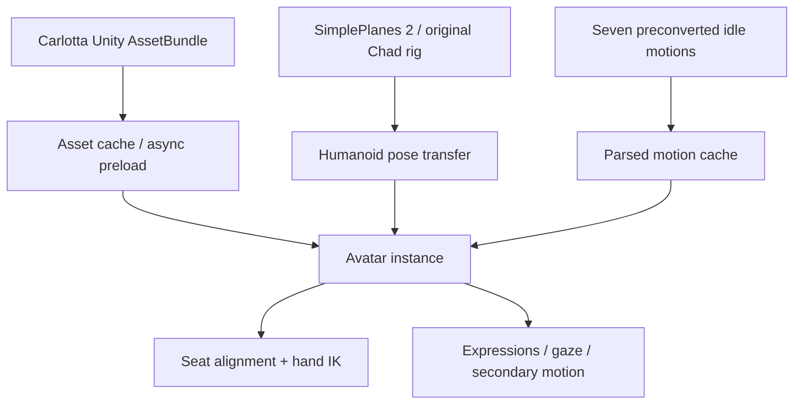

# Development Progress & Engineering Log

> **SimplePlanes 2 — Chad to Carlotta Avatar Replacement**  
> Last updated: **2026-11-08** · Internal development build: **v86.14 (experimental)** · Public README version: **v0.1**
>
> **Scope:** Engineering notes and local test results, not a public release announcement or a compatibility guarantee.

## 1. Project objective

The project began as an unofficial replacement of the default **Chad** avatar with **Carlotta** in *SimplePlanes 2*. The larger goal is to evolve the prototype into a **general-purpose VRM avatar loader**: eventually, a user should be able to supply a compatible `.vrm` model without rebuilding a character-specific Unity AssetBundle.

**Current limitation:** the working implementation **does not load arbitrary `.vrm` files at runtime**. It still loads a Carlotta-specific Unity AssetBundle. Compatibility with other models, automatic body calibration, and direct VRM import remain future work.

## 2. Current architecture

The existing game character remains the source of animation. The mod transfers human poses to the replacement avatar and adapts its seating, hands, gaze, expressions, and secondary motion. The project supports the Main Menu, Build/Designer, Fly/Terrain and on-foot contexts, with scene-specific behavior and restore-to-Chad controls. Those features are subject to ongoing regression testing.

## 3. Engineering milestones

| Stage / internal builds | Engineering work | Key lesson / status |
|---|---|---|
| Early experiments, v0.2–v51 | Replacement skeleton, rendering, face/eye and depth/shader fixes | Skinned meshes, material queues and camera clipping require separate diagnostics. |
| v55–v82.4 | Expressions, gaze, movement states, hair/clothing secondary motion, VRMA retargeting | Rest/T-pose mapping was revised at v75; several hair collision/inertia experiments were intentionally rolled back. |
| v86.8–v86.11 | Fly ↔ Build seating correction and aircraft-aware snapshots | Reusing the seat snapshot across different aircraft caused a regression; craft identity and geometry matter. |
| **v86.12 Fix1** | AssetBundle retention and attach/detach performance instrumentation | Cached assets helped repeated transitions, but animation initialization remained expensive. |
| **v86.13** | Parsed motion cache and more detailed per-stage diagnostics | Large reduction in *warm attach CPU time*, confirmed in local logs. |
| **v86.14 (experimental)** | Async cold AssetBundle/prefab preload | First attach no longer includes the large synchronous bundle load; actual frame pacing still needs measurement. |

These are **internal engineering build numbers** and should not be confused with the separate **public v0.1** label in the README.

## 4. Performance investigation — 7–8 November 2026

### 4.1 The problem

Loading Carlotta for the first time and switching game contexts caused perceptible hitches. Two suspected contributors were the relatively large character asset and repeatedly initializing seven converted idle motions.

The game-side AssetBundle measured **21.48 MiB**; the seven `.spmotion` files totaled **4.18 MiB**. File sizes alone do not determine runtime memory, GPU upload cost, or frame stutter.

### 4.2 Changes and measured results

**Metric definition:** `PERF_ATTACH` measures **synchronous CPU elapsed time within the avatar attachment routine**, not the complete scene transition time or end-to-end frame latency.

| Local test | Cold / first attach | Warm subsequent attach | Sample size |
|---|---:|---:|---|
| **v86.12 Fix1** | **1,664 ms average** | **97.6 ms average** | cold n=2; warm n=18 |
| **v86.13** | **1,542 ms** | **7.8 ms average** | cold n=1; warm n=11 |
| **v86.14 (async enabled)** | **151 ms** after preload | **7.8 ms average** | first n=1; next n=5 |

- **Warm-attach improvement, v86.12 → v86.13:** approximately **92.0%** (97.6 → 7.8 ms). This is a comparison of separate local sessions, not a controlled frame-time benchmark.
- **First synchronous attach, v86.13 → v86.14:** **1,542 → 151 ms** (approximately **90.2% lower**) when async preload has already completed. The time spent preloading was **moved outside** `PERF_ATTACH`, not eliminated.
- **v86.14 preload trace:** `bundleWaitMs=5528`, `prefabWaitMs=247`, `totalWaitMs=5775`. These are **asynchronous elapsed wait times**, **not 5,775 ms of confirmed frozen frames**. Time until the avatar appears may be affected.
- **v86.14 first-attach detail:** 74 ms motion processing (including 66 ms initial parse), 40 ms material work, 21 ms scene/skinning setup; other stages accounted for the remainder.
- **Motion cache verification:** in a 12-attach v86.13 session, the first attach produced 7 cache misses and later attaches reused 7 clips each, for **77 hits / 7 misses** overall.

### 4.3 What improved — and what is not yet proven

**Verified from local logs:** the cache is being used, repeat avatar attachment takes far less synchronous CPU time, and v86.14's async preload reached its ready state.

**Not yet proven:** a 90% improvement in the game's actual frame stutter, improved 1% low FPS, memory stability over long sessions, or universal compatibility. `PERF_DETACH=0 ms` does **not** include Unity's deferred destruction or possible later garbage collection.

One preload diagnostic showed `startupAgeMs=-2002`, an invalid startup-age reading. That timer should be corrected before relying on startup-age comparisons.

## 5. Regressions and engineering decisions

**Do not repeat these earlier mistakes:**

- **Animations:** using a moving Chad pose as the VRMA T-pose baseline distorted the retargeting; the v75 fixed rest-pose approach must be retained.
- **Seats:** Fly → Build seat snapshots must not be blindly reused for unrelated aircraft; aircraft-aware validation was introduced later.
- **Hair physics:** older experimental collision and inertia modifications were rolled back; an old version is not automatically a safe improvement.
- **Rendering:** eye/sclera/depth/material fixes were highly character-specific and should not be generalized without testing.
- **Caching:** animation keyframe data can be reused, but per-avatar bone bindings and rest-rotation transforms must be recomputed for the new instance.

## 6. Roadmap toward a general-purpose VRM loader

| Phase | Planned work | State |
|---|---|---|
| A. Stabilize Carlotta | Profile frame-time spikes, fix diagnostic timer, investigate initial motion parse and material setup | In progress |
| B. Remove hard-coded assumptions | Isolate Carlotta-only mesh names, expression indices, spring bone names and material rules | Planned |
| C. Second-character test | Load a second, appropriately licensed VRM via the *existing* AssetBundle path; compare rigs, seats and IK | Planned |
| D. Direct VRM import | Evaluate runtime VRM 0.x/1.0 import and Unity/BepInEx compatibility, with safe failure recovery | Not implemented |
| E. Automatic adaptation | Bone mapping, body measurements, cockpit seating, hand reach, expression and spring settings | Not implemented |

“Universal” refers to compatible, standards-compliant VRM humanoids. It is **not** a promise that every VRM will work perfectly with zero manual adjustment.

## 7. Test methodology and next measurements

Future experiments will compare the **same scene, aircraft, settings and machine** across multiple clean process launches, and report:

1. Cold and warm attachment CPU timings (mean, maximum, sample size).
2. Async preload start/ready timestamps and time to first visible avatar.
3. Frame times, including long-tail spikes (P95/P99 and maxima), during startup and scene transitions.
4. Memory usage, GC activity and repeated attach/detach behavior.
5. Functional regressions: Main Menu, Designer, Fly, on-foot, swimming/falling, cockpit hands, seating across aircraft, expressions, gaze and F8 restore.

## 8. Distribution and attribution

This is an **unofficial fan research/modding project**, not affiliated with the game developer or the character IP owner. Character models, textures, third-party motion files and game binaries are **not included** in this document. Their redistribution requires a separate rights/license review.

> **Status note:** This document reports locally observed behavior and inspected implementation details as of **8 November 2026**. It is not a release announcement, and future patches may change these findings.
