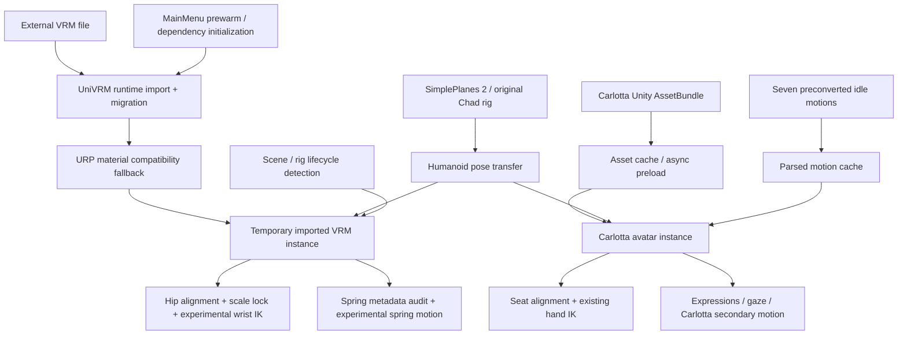

# Development Progress & Engineering Log

> **SimplePlanes 2 — Chad to Carlotta Avatar Replacement / Experimental Runtime VRM Loader**  
> Last updated: **2026-11-10** · Latest locally tested experimental build: **v86.19-K (SpringMotion Syntax Fix1)** · Public README version: **v0.1**
>
> **Scope:** Engineering notes and local test results, not a public release announcement or a compatibility guarantee. Internal build numbers and public release versions are separate.

## 1. Project objective and current status

The project began as an unofficial replacement of the default **Chad** avatar with **Carlotta** in *SimplePlanes 2*. The larger goal is a **general-purpose VRM avatar loader**: users should eventually be able to supply a compatible `.vrm` model without rebuilding a character-specific Unity AssetBundle.

There are now **two distinct implementation paths**:

- **Established Carlotta path:** loads the Carlotta-specific Unity AssetBundle and retains the existing expressions, gaze, seat alignment, hand IK, secondary motion and other game integrations. It remains the reference implementation.
- **Experimental runtime-VRM path (v86.19):** loads an external VRM directly via UniVRM, applies a material compatibility fallback, retargets the game's Humanoid pose, and temporarily overlays the imported avatar in Main Menu, Designer or Terrain. This has been **tested with Cartethyia.vrm**, not validated for arbitrary VRM models.

**Current limitation:** direct runtime VRM import is **implemented and locally demonstrated**, but it is **not yet a persistent, production-ready replacement system**. The new overlay runs for approximately 20 seconds and restores the original Carlotta display afterward. General-purpose cockpit grips, torso adaptation, clothing collision and broad multi-avatar compatibility remain unfinished.

## 2. Current architecture

The game character remains the animation source. The established Carlotta pipeline and the new imported-VRM pipeline are currently separate. New features preserve the original Chad/Carlotta objects and are enabled through isolated test settings; they should not be interpreted as full feature parity.

## 3. Engineering milestones

| Stage / internal builds | Engineering work | Key lesson / status |
|---|---|---|
| Early experiments, v0.2–v51 | Replacement skeleton, rendering, face/eye and depth/shader fixes | Skinned meshes, material queues and camera clipping require separate diagnostics. |
| v55–v82.4 | Expressions, gaze, movement states, hair/clothing secondary motion, VRMA retargeting | Rest/T-pose mapping was revised at v75; several hair collision/inertia experiments were intentionally rolled back. |
| v86.8–v86.11 | Fly ↔ Build seating correction and aircraft-aware snapshots | Reusing the seat snapshot across different aircraft caused a regression; craft identity and geometry matter. |
| **v86.12 Fix1** | AssetBundle retention and attach/detach performance instrumentation | Cached assets helped repeated transitions, but animation initialization remained expensive. |
| **v86.13** | Parsed motion cache and more detailed per-stage diagnostics | Large reduction in *warm attach CPU time*, confirmed in local logs. |
| **v86.14 (experimental)** | Async cold AssetBundle/prefab preload | First attach no longer includes the large synchronous bundle load; actual frame pacing still needs measurement. |
| **v86.19-A–D** | Direct UniVRM loading, dependency resolution, material fallback and alpha handling | Cartethyia runtime import succeeded without an avatar-specific AssetBundle. |
| **v86.19-E** | Humanoid pose copy using `HumanPoseHandler` | 95 muscle values copied per frame; visible animation confirmed. |
| **v86.19-F–H** | MainMenu, Designer and Terrain pilot overlay; scene waiting, rig detection and MainMenu prewarm | Temporary pilot replacement works in all three scenes; runtime-type initialization needs controlled ordering. |
| **v86.19-I** | Experimental hand/wrist target measurement and two-bone IK | Measured reductions in wrist error; unreachable targets remain. |
| **v86.19-J** | Scale lock, SpringBone metadata and skinning analysis | Scale preserved across seat/on-foot rebinds; formal spring roots and weighted skirt bones identified. |
| **v86.19-K (latest tested)** | Read-only spring mapping and optional seat-aware spring motion | All 18 official spring roots mapped; Apply executed on imported bone chains while on foot. |

These are **internal engineering build numbers**, not public release versions. Intermediate experimental patches and syntax/assembly fixes are not all listed separately.

## 4. Performance investigation — 7–8 November 2026

### 4.1 The problem

Loading Carlotta for the first time and switching game contexts caused perceptible hitches. Two suspected contributors were the relatively large character asset and repeatedly initializing seven converted idle motions.

The game-side AssetBundle measured **21.48 MiB**; the seven `.spmotion` files totaled **4.18 MiB**. File sizes alone do not determine runtime memory, GPU upload cost, or frame stutter.

### 4.2 Changes and measured results

**Metric definition:** `PERF_ATTACH` measures **synchronous CPU elapsed time within the avatar attachment routine**, not the complete scene transition time or end-to-end frame latency.

| Local test | Cold / first attach | Warm subsequent attach | Sample size |
|---|---:|---:|---|
| **v86.12 Fix1** | **1,664 ms average** | **97.6 ms average** | cold n=2; warm n=18 |
| **v86.13** | **1,542 ms** | **7.8 ms average** | cold n=1; warm n=11 |
| **v86.14 (async enabled)** | **151 ms** after preload | **7.8 ms average** | first n=1; next n=5 |

- **Warm-attach improvement, v86.12 → v86.13:** approximately **92.0%** (97.6 → 7.8 ms). This is a comparison of separate local sessions, not a controlled frame-time benchmark.
- **First synchronous attach, v86.13 → v86.14:** **1,542 → 151 ms** (approximately **90.2% lower**) when async preload has already completed. The time spent preloading was **moved outside** `PERF_ATTACH`, not eliminated.
- **v86.14 preload trace:** `bundleWaitMs=5528`, `prefabWaitMs=247`, `totalWaitMs=5775`. These are **asynchronous elapsed wait times**, **not 5,775 ms of confirmed frozen frames**. Time until the avatar appears may be affected.
- **v86.14 first-attach detail:** 74 ms motion processing (including 66 ms initial parse), 40 ms material work, 21 ms scene/skinning setup; other stages accounted for the remainder.
- **Motion cache verification:** in a 12-attach v86.13 session, the first attach produced 7 cache misses and later attaches reused 7 clips each, for **77 hits / 7 misses** overall.

### 4.3 What improved — and what is not yet proven

**Verified from local logs:** the cache is being used, repeat avatar attachment takes far less synchronous CPU time, and v86.14's async preload reached its ready state.

**Not yet proven:** a 90% improvement in the game's actual frame stutter, improved 1% low FPS, memory stability over long sessions, or universal compatibility. `PERF_DETACH=0 ms` does **not** include Unity's deferred destruction or possible later garbage collection.

One preload diagnostic showed `startupAgeMs=-2002`, an invalid startup-age reading. That timer should be corrected before relying on startup-age comparisons.

**Separate metric:** recent UniVRM imports of Cartethyia took approximately **2–5 seconds** in individual local sessions. Those wall-clock import times are not directly comparable to the old Carlotta `PERF_ATTACH` measurements, and do not establish improved end-to-end frame pacing.

## 5. Regressions and engineering decisions

**Do not repeat these earlier mistakes:**

- **Animations:** using a moving Chad pose as the VRMA T-pose baseline distorted retargeting; the v75 fixed rest-pose approach must be retained.
- **Seats:** Fly → Build seat snapshots must not be reused blindly for unrelated aircraft; aircraft-aware validation was introduced later.
- **Hair physics:** older experimental collision and inertia modifications were rolled back; an old version is not automatically a safe improvement.
- **Rendering:** eye/sclera/depth/material fixes were character-specific and should not be generalized without testing.
- **Caching:** animation keyframe data can be reused, but per-avatar bone bindings and rest-rotation transforms must be recomputed for each instance.
- **Scene startup:** MainMenu/Designer/Terrain objects appear after Startup/Transition; a one-shot scene check can miss the intended scene. Wait for the actual scene and stable rig.
- **UniVRM loading:** Mono type validation and `Vrm10NopSpringboneRuntime` construction failed when first attempted inside Designer. MainMenu prewarm enabled later imports in Designer and Terrain; the exact lower-level loader incompatibility is not independently proven.
- **Scale calibration:** using animated renderer bounds on every bind caused different scale estimates for seated and standing poses. Preserve the initially applied factor across rebinds.
- **Build safety:** v86.19-J initially missed the `UnityEngine.JSONSerializeModule` reference; v86.19-K initially had a misplaced brace causing cascading syntax errors. Both were corrected before successful in-game testing. A failed build must not replace the installed plugin.

## 6. Runtime VRM import and rendering — v86.19-A–D

The experimental loader directly imports an external `.vrm` through UniVRM rather than requiring a character-specific AssetBundle.

### 6.1 Implemented

- Separate UniVRM runtime dependency loading and diagnostics.
- VRM 0.x migration through the UniVRM10 importer.
- Configurable `.vrm` filename under the avatar directory.
- Imported Animator / Humanoid / skinned renderer / blend-shape validation.
- Isolation from the existing Carlotta replacement and cleanup when the preview ends.
- Compatibility shader helper selecting an available URP/Unlit shader when the expected MToon shader is unavailable.
- glTF `alphaMode` handling for transparent versus opaque materials.

### 6.2 Observed Cartethyia result

| Property | Local test result |
|---|---:|
| Direct VRM import | Success |
| Humanoid mapped bones | 15/15 |
| Skinned renderers | 7 |
| Material slots / textures present | 10 / 10 |
| Blend shapes detected | 11 |
| `BLEND` materials | 3 (render queue 3000) |
| `OPAQUE` materials | 7 (render queue 2000) |

**Limitation:** URP/Unlit is a visual compatibility fallback, **not full VRM/MToon rendering**. Transparency is approximated and differences in shading, culling, depth writing, outlines and hair appearance may remain. Import success with Cartethyia does not establish general VRM 0.x/1.0 compatibility.

## 7. Humanoid retargeting and pilot overlays — v86.19-E–H

### 7.1 Pose transfer (E)

`HumanPoseHandler` transfers 95 Humanoid muscle parameters from the source Chad Animator to the imported VRM. Continuous copy was recorded in the runtime log, and the imported model visibly moved beyond its T-pose.

### 7.2 Main Menu overlay (F)

The imported avatar was positioned relative to the original Carlotta hips, while the existing Carlotta renderers were temporarily hidden. The overlay ran for 20 seconds, then restored the original character.

### 7.3 Scene survey (G)

| Game context | Unity scene | Observed Chad rig | Typical parent |
|---|---|---|---|
| Main Menu | `MainMenu` | `ChadAirlineRigged(Clone)` | `ChadContainer` |
| Build | `Designer` | `ChadFSRigged(Clone)` | `Seat_Ejection` |
| Fly / on foot | `Terrain` | `ChadFSRigged` or `ChadAirlineRigged(Clone)` | `Graphics` |

Pilot objects can temporarily disappear and be recreated, including within Terrain. Rig identity should therefore be checked during runtime instead of caching a single named object indefinitely.

### 7.4 Build / Fly overlay (H)

The imported VRM was placed at the pilot location in both Designer and Terrain, preserving the original game rigs. The system waits for scene readiness and a stable Chad/Carlotta pair, rebinding on subsequent rig changes. One Mono type-loading issue was resolved in local testing through MainMenu prewarming of managed UniVRM dependencies.

**Verified:** direct import, Humanoid retargeting, hip alignment, temporary renderer hiding, and restoration in the tested scenes. **Not yet implemented:** permanent runtime replacement or feature parity with Carlotta's cockpit controls and expressions.

## 8. Wrist IK and body-proportion adaptation — v86.19-I

The new avatar's body proportions differ from Chad and Carlotta. Copying another character's hand target alone can leave hands floating near controls or place targets beyond the avatar's reach.

### 8.1 Implemented and measured

- Separate `Measure` and `Apply` modes.
- Left/right wrist distance diagnostics against the Carlotta reference.
- Experimental two-bone arm IK with configurable strength.
- Reach-limit clamping and diagnostics for the shoulder-to-target distance.
- Original Chad and Carlotta rigs are not rewritten by the experimental wrist solver.

One Fly test recorded:

| Wrist error | Left | Right |
|---|---:|---:|
| Before correction | 18.24 cm | 16.93 cm |
| After correction | 11.20 cm | 10.02 cm |
| Relative reduction | 38.6% | 40.8% |

Both arms repeatedly hit their reach limits in some seated poses. In subsequent tests, shoulder-to-target distances exceeded the approximately 36 cm measured arm reach, with several centimeters of reach deficit depending on pose. Residual wrist errors remain significant.

### 8.2 Limitations

The solver currently targets **reference wrists**, not actual joystick or throttle contact surfaces. It does not yet solve hand-palm contact, grip orientation, finger curl, shoulder translation, torso lean or coordinated whole-body posture. Increasing IK strength cannot eliminate errors caused by physically unreachable targets.

## 9. Scale lock and physics metadata audit — v86.19-J

### 9.1 Seated / walking scale consistency

The old scale estimate used rendered bounds, which change across animation poses. In a seat-to-on-foot transition, the observed scale estimate changed while the model's chosen scale should not.

| Observation | Initial seated | After transition |
|---|---:|---:|
| Recomputed factor (`autoScaleObserved`) | ~0.77 | ~1.25–1.67 in different tests |
| Factor actually applied with `ScalePolicy=Locked` | ~0.77 | ~0.77 |

The imported model's scale was held through a reported second bind; the visual appearance still requires cross-avatar regression testing. `ScaleMultiplier` remains user-controlled.

### 9.2 Cartethyia SpringBone and skinning audit

The initial `JsonUtility` metadata parse failed; a bounded JSON fallback recovered the VRM0 spring metadata.

| Diagnostic | Result |
|---|---:|
| glTF nodes | 266 |
| Imported transforms | 349 |
| Skinned meshes | 7 |
| Weighted transforms | 236 |
| Official SpringBone groups | 2 |
| Official spring-root references | 18 |
| Spring root matches in weighted imported hierarchy | 18 |
| Embedded spring collider groups / colliders | 0 / 0 |
| Weighted skirt / clothing candidates | 8 |
| Weighted hair-named candidates | 110 |

The eight detected skirt bones have skinning contributions but are **not registered as official SpringBone roots**. Their names and skinning weights make them candidates for further analysis, not proof that automatic physics is safe. A rigid sleeve may have no separately controllable sleeve bones at all.

## 10. Experimental spring motion — v86.19-K

### 10.1 Implementation

- VRM metadata-derived spring-root mapping.
- Optional, imported-avatar-only spring calculations.
- `Inspect` mode for read-only bone and seat-state diagnostics.
- `Apply` mode for constrained motion with gravity/damping parameters and angular limits.
- Seat-state detection based on observed animation/rig context.
- Motion reset on state change or abnormally large frame gaps.
- Cleanup/restoration of imported bone transforms on overlay termination.
- Clothing candidates can be identified separately; clothing simulation is disabled in the verified test.

### 10.2 Verified Inspect and Apply logs

| Metric | Observed result |
|---|---:|
| Official roots | 18 |
| Matched roots | 18 |
| Unmatched roots | 0 |
| Derived spring links | 103 |
| Additional clothing links in tested configuration | 0 |
| Apply-mode frames with motion writes | 901 |
| Reported peak rotation | 10.00° (configured limit) |
| Imported bones restored on shutdown | Yes |
| Writes to original pilot rigs | No |

The seated state was identified using the `_EVAChairIdleCockpit` animation context. After exiting, the log changed to `seated=False`, and spring writes began. An approximately 20-second overlay subsequently cleaned up and restored the original Carlotta renderers.

**Interpretation:** the solver executes and affects imported transforms; this does **not** prove visually natural motion, correct cloth draping or collision-safe behavior. `peakAngleDeg=10.00` shows the angular constraint was reached, not that the simulation is physically correct.

**Known missing capabilities:** cockpit collision, body/cloth self-collision, accurate sleeve draping, full VRM 1.0 per-joint support, and systematic visual testing with other VRMs.

## 11. Engineering plan: automatic cockpit calibration and clothing adaptation

### 11.1 Contact-aware cockpit grip

A correct grip requires more than reproducing Chad's wrist transform. The proposed next system will:

1. Detect and track joystick, throttle and other cockpit control objects, using game components/transforms where available.
2. Identify plausible handle axes and grip surfaces; use the original pilot animation as secondary evidence when object geometry is unavailable.
3. Estimate each VRM's palm, fingers, hand size and arm reach from its actual rig.
4. Generate wrist position **and rotation** targets that place the palm on the handle rather than the fingertips at an arbitrary point.
5. Solve shoulder/elbow/wrist/finger posture with joint limits and collision checks where feasible.
6. If a target is unreachable, prefer bounded shoulder/torso lean while keeping the pelvis seated; do **not** artificially stretch arm bones.
7. Update targets as the throttle and stick move, with in-game diagnostics and calibration cache per avatar/aircraft/seat.

These are **planned designs**, not features implemented in v86.19-K. Automatic identification is not guaranteed for all user-built aircraft or control meshes.

### 11.2 Model-aware clothing and spring motion

Different VRMs may have no sleeves, short sleeves, long rigid sleeves, independently rigged fabric, or skirt bones not listed in SpringBone metadata. The planned controller will distinguish:

- Official VRM spring chains: candidates for metadata-driven secondary motion.
- Additional weighted, deformable clothing chains: candidates only after structural and geometry validation.
- Clothing without independent deformable bones: no automatic fold can be assumed; optional mesh deformation or avatar-specific adjustments may be necessary.
- Seated poses: use body/seat/cockpit envelopes to constrain motion and gradually relax into valid poses, rather than blindly turning all physics off.

Uncertain bone classifications should default to **no automatic transform writes**.

## 12. Roadmap toward general-purpose VRM support

| Phase | Planned work / result | Status as of 2026-11-10 |
|---|---|---|
| A. Stabilize Carlotta | Profile frame spikes and regressions, retain existing motion and seat fixes | Ongoing; v86.12–14 improvements measured |
| B. Remove hard-coded assumptions | Separate Carlotta-only expressions, mesh names, physics and IK rules | Partially implemented in experimental modules |
| C. Multi-character validation | Test additional appropriately licensed VRMs and compare geometry, shaders and rigs | Not systematically tested |
| D. Direct runtime VRM import | UniVRM loader, runtime dependencies, material compatibility and safe cleanup | **Experimentally demonstrated with Cartethyia** |
| E. Humanoid / scene adaptation | MainMenu, Designer, Terrain and on-foot retargeting with rig rebinds | **Temporary overlay demonstrated** |
| F. Wrist and body adaptation | Wrist measurement, experimental two-bone IK, scale preservation | **Partially implemented; large residual errors** |
| G. VRM secondary motion | Official SpringBone parsing and experimental seat-aware motion | **Inspect and Apply demonstrated; no collision solver** |
| H. Contact-aware cockpit IK | Joystick/throttle geometry detection, grip, fingers, torso lean | Planned |
| I. Clothing collision and draping | Model-aware sleeves/skirts, body and cockpit constraints | Planned |
| J. Production integration | Persistent avatar switching, resource reuse, broad regression/performance validation | Planned |

“General-purpose” means a framework intended to support compatible VRM humanoids with model-aware adaptation; it is **not** a guarantee that every VRM will work without configuration or authoring changes.

## 13. Test methodology and next measurements

Future experiments should compare the **same scene, aircraft, settings and machine** across multiple clean process launches, and report:

1. Cold and warm attachment CPU timings, including mean, maximum and sample size.
2. Async preload start/ready timestamps and time to first visible avatar.
3. Actual frame times, including P95/P99, long-tail spikes and maxima, during startup and transitions.
4. Memory usage, GC activity and repeated attach/detach behavior.
5. Lifecycle regressions across MainMenu, Designer, Terrain, boarding, exiting, walking, swimming/falling and return to menu.
6. Spatial measurements: scale, pelvis alignment, arm reach, hand-to-handle contact and finger penetration.
7. SpringBone stability: seat-state transitions, angle limits, frame-gap resets, object and body collisions, and restore behavior.
8. Multiple independently sourced VRM 0.x/1.0 models with distinct rigs, proportions, materials and clothing.

**Evidence discipline:** distinguish successful log execution from visual/physical correctness; do not equate CPU attach time with frame time; do not label an approximate 20-second overlay as persistent avatar replacement.

## 14. Distribution and attribution

This is an **unofficial fan research/modding project**, not affiliated with the game developer or the character IP owner. Character models, textures, third-party motion files, game binaries and proprietary Unity assets are **not included** in this document. Redistribution requires separate rights/license review.

Development packages may include source, build/install/rollback scripts and diagnostics. Public source releases should avoid bundling third-party game DLLs, copyrighted VRM assets or material extracted from the game unless distribution is authorized. Test results reported here reflect local environments, not guaranteed compatibility.

> **Status note (2026-11-10):** The original Carlotta AssetBundle-based replacement remains the established path. The external runtime-VRM pipeline has been demonstrated with Cartethyia through v86.19-K, including optional experimental spring motion. Persistent generalized replacement, robust cockpit interaction and collision-aware clothing remain development work.
